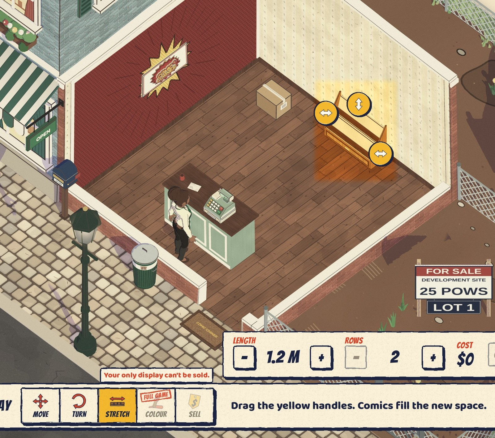
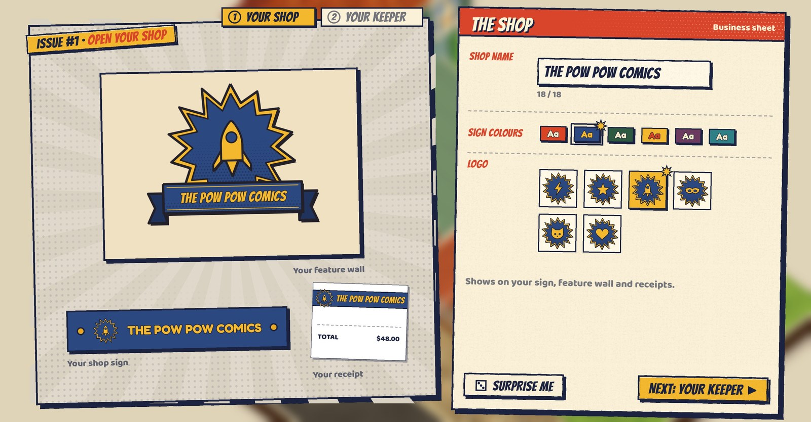

Hey everyone, and welcome to the very first Comic Corner dev blog!

I'm Drew, the solo dev behind Wattlebird Games, here in Australia. I'll be posting here whenever there's something new to show, so you can follow along as the game comes together.

## Why a comic shop?

As a kid, I loved reading. What made comics stand out for me was the art and the atmosphere they could create, beyond just the words on the page. They always felt more immersive than your average book.

So when I was thinking about what my first game should be, the idea was simple: open and run your own comic book shop.

## What I grew up playing

I've always loved the world of gaming. I love the way developers keep pushing the limits of technology, but I'm just as happy with a retro style game.

My first ever console was the SEGA Mega Drive, and the Theme games by Bullfrog were my absolute favourites. Theme Park and Theme Hospital, I played them for hours. Simulation and strategy games are still my favourite genres, but lately I've really taken a liking to more casual, cosy games too.

That's exactly where Comic Corner sits.

*Every shop starts like this. One box, one wall.*

## Watching it come to life

My favourite part so far has been taking that simple idea and watching it come to life on screen, piece by piece. The hand-drawn UI is styled to look like comic books. I've planned out the comic series that will be in the shop, each with its own covers. Every small piece is building a world you can kick back and relax in.

*Even the loading screen is a comic cover.*

*The Pow Book, where you track your milestones.*

*Cloud Pirates, issues 30 to 34. One of the many series you'll stock.*

## The hardest bit (so far)

I'm a bit of a perfectionist, so getting every little detail right is really important to me. The most challenging part has been making the gameplay feel intuitive and easy.

A good example is the shelves. Instead of buying more shelves, you can simply stretch out the one you have to make more room for your displays. They stretch up and sideways. It would have been much easier to just have fixed-size shelves (believe me, I thought about it!), but this way gives you so much more flexibility.

*Grab the yellow handles and stretch. The comics fill the new space.*

## Where it's heading

Cosy games are meant to be low-stress, with no failing. In Comic Corner, you'll watch your tiny store grow with new comics, merch, fixtures and displays. You'll be able to make it the store of your dreams, right down to the floors, the walls, the signage and the decorations.

Every store starts the same, but as your business grows, no two stores will ever look the same!

*It starts with naming your shop and picking your sign and logo.*

*Closing time on the corner.*

Comic Corner is coming to Steam, with a free demo on the way. I'll keep posting honest updates here about what I've been working on, the good bits and the tricky bits.

If you'd like to chat about the game, share ideas or just say hi, come and join us on the [Wattlebird Games Discord](https://discord.gg/7C2AYfKsSu). I'd love to see you there!

Drew
