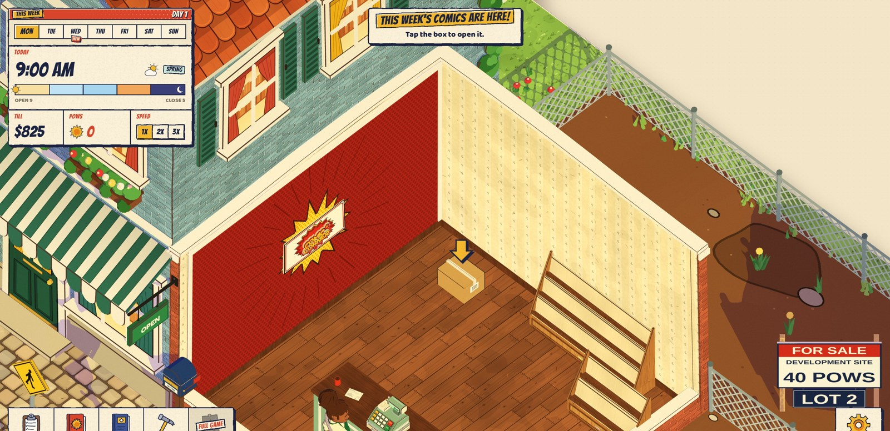
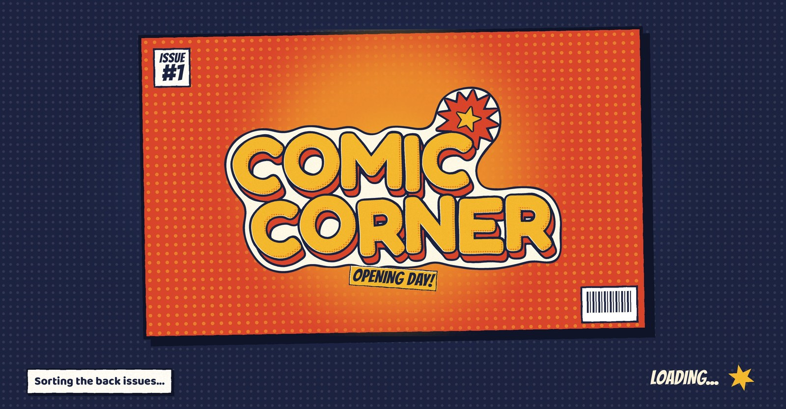
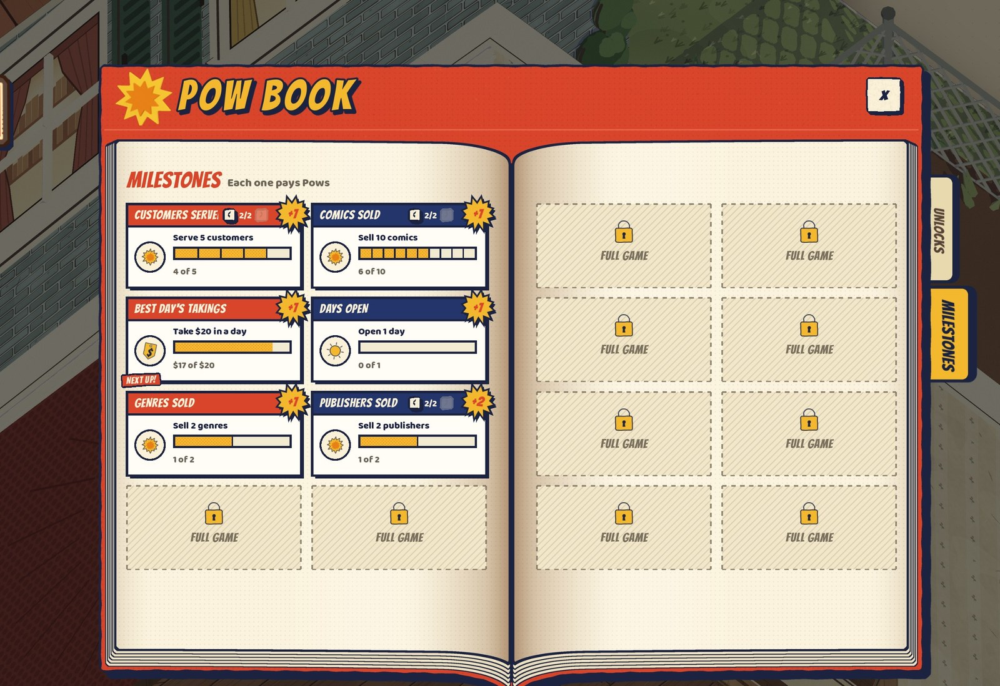
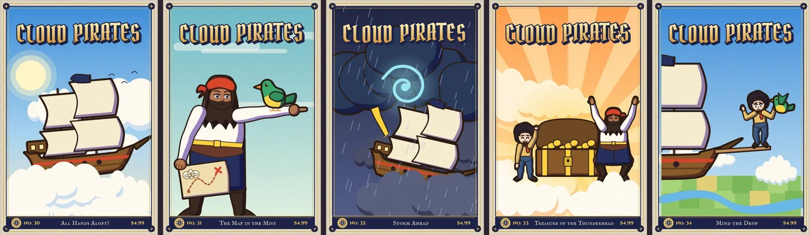
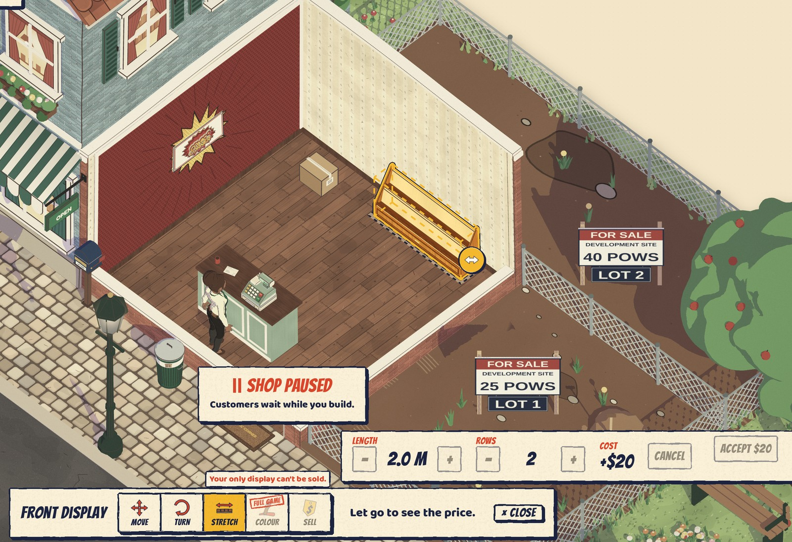
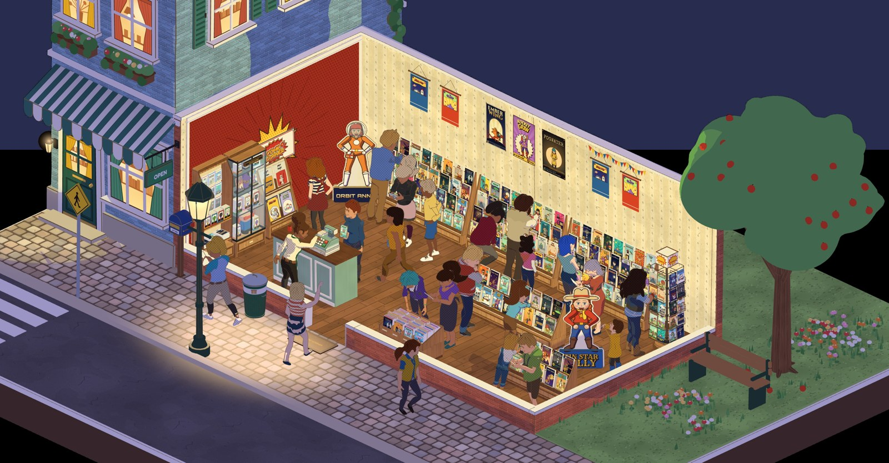

Hey everyone, and welcome to the very first Comic Corner dev blog!

I'm Drew, the solo dev behind Wattlebird Games here in Australia. This is where I'll share how the game is coming along, what I've been working on and what's coming next. Grab a cuppa and pull up a stool.

## Why a comic shop?

I've always been a reader, but comics had something books didn't. The art did half the storytelling. A single panel could set the whole mood before you'd read a word, and you felt like you were *in* that world, not just reading about it.

That feeling stuck with me. So when it came time to choose my first game, the idea came easily: what if you could open your own little comic shop and fill it with that same atmosphere?

## Where it all started for me

My first console was a SEGA Mega Drive, and I lost a lot of my childhood to the Theme games by Bullfrog Productions. Theme Park and Theme Hospital were my absolute favourites. I loved building something from nothing and watching people wander through it.

I'm still a simulation and strategy fan at heart, but lately I've found myself reaching for cosier games, the kind you can relax into at the end of a long day. Comic Corner sits right in the middle of those two loves.

*Every shop starts like this. One box, one wall.*

## Watching it come to life

The best part of making this game has been watching a simple idea turn into a real place on screen, one piece at a time.

The menus are drawn to look like comic books. Even the loading screen is a comic cover. Every series on your shelves has been planned out with its own look and its own run of issues, so the shop feels like it's stocked with real comics.

*Even the loading screen is a comic cover.*

*The Pow Book, where you track your milestones and earn Pows.*

*Cloud Pirates, issues 30 to 34. Just one of the series you'll stock.*

## The hardest bit (so far)

I'll admit it, I'm a bit of a perfectionist. The trickiest thing hasn't been making things look nice, it's been making them feel easy. If you have to stop and think about how something works, it's not finished yet.

The shelves are a good example. Rather than buying more and more of them, you grab the one you've got and stretch it. Longer, taller, whatever your wall needs, and the comics shuffle along to fill the new space. Fixed-size shelves would have been far simpler to build (believe me, I was tempted!), but this feels so much better to play.

*Grab the yellow handle and stretch. The comics fill the new space.*

## Where it's heading

Comic Corner is a cosy game, so there's no failing and no stress. It's all about watching your tiny shop grow. New comics arrive, the regulars start popping in, and bit by bit you add new displays and merch.

Then you make it yours. You name your shop and choose your sign and logo, then pick the flooring and wallpaper and decorate it however you like. Every shop starts out exactly the same, but give it a few weeks and no two will ever look alike.

*It all starts with naming your shop.*

*Closing time on the corner.*

## Come along for the ride

Comic Corner is coming to Steam, with a free demo on the way. I'll keep posting honest updates here, the wins and the head-scratchers.

If you'd like to chat about the game, share ideas or just say g'day, come and join us on the [Wattlebird Games Discord](https://discord.gg/7C2AYfKsSu). I'd love to see you there!

Drew
